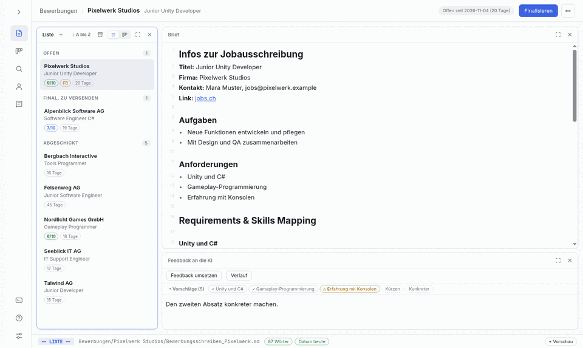
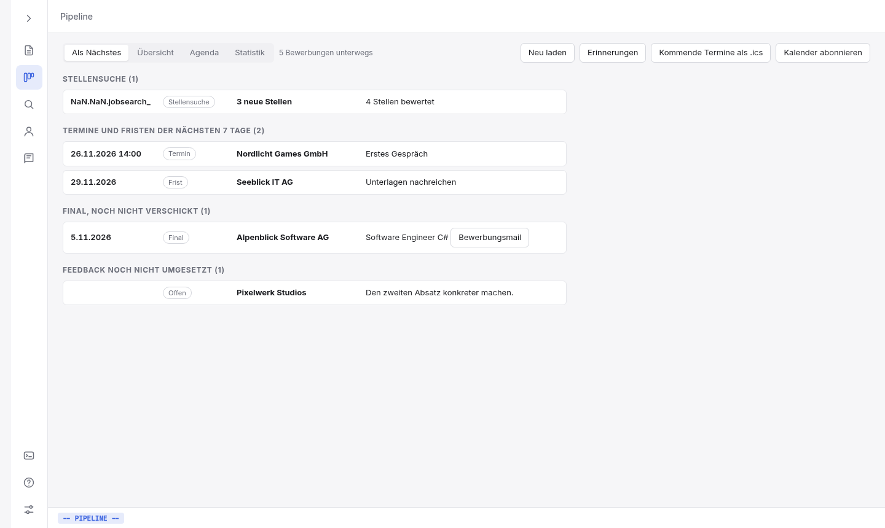
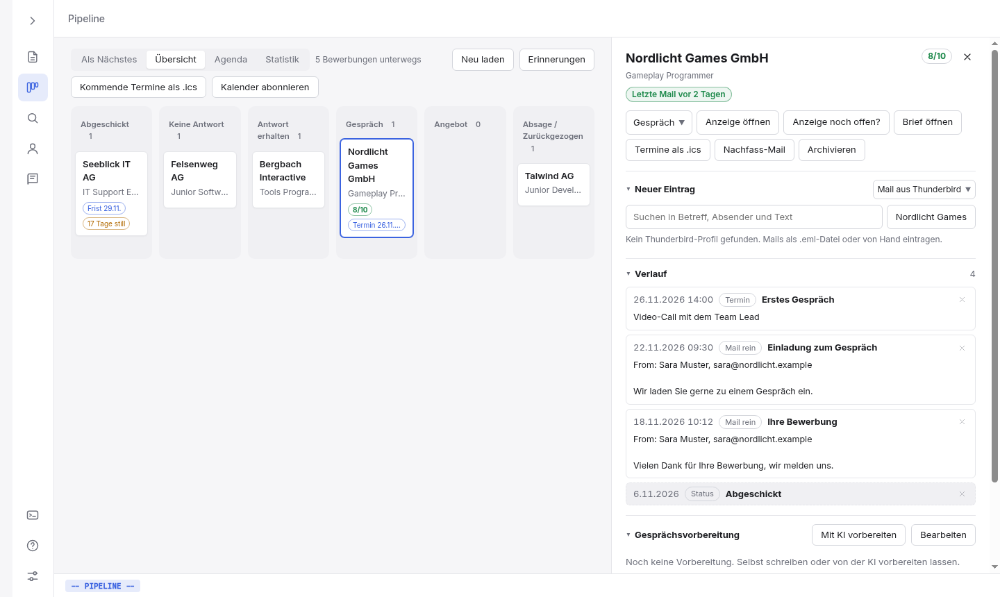

<p align="center"></p>

# Application Board

A local tool for job applications that runs in the browser. You can review cover letters and revise them with AI, finalize them as Word and PDF, and search for matching jobs and rate them. After you send an application, the board keeps track of mails, appointments and interview preparation. You choose the AI yourself; nothing is tied to one provider.

Everything stays on your own computer. The server only listens on `127.0.0.1`, and the data is plain Markdown and JSON files in a folder of your own.

Up to version 0.5.0 the app was called Bewerbungs-Board. It started out in German, which is why the file and folder names of the data folder stay German (see below).

<p align="center"></p>

The interface is in German and English (Settings → General). Your data keeps the language you write it in: a German letter stays German, an English one stays English. New files the app creates (logs, job search results, example profile) use the interface language.

## Features

- **Applications:**
  - List or board view (Open, Final, Sent), plus an archive for finished ones
  - New application from a link or a pasted posting (`n`): the AI writes the draft, in the tone you pick (formal, warm, concise)
  - Earlier versions of every letter with diff and restore (`v`)
  - Spell check in the language of the letter, and a rule check (word range, forbidden characters) from your profile
  - Editor with Vim mode and live Markdown, preview, freely arranged panels
  - Write feedback for the AI and apply it with one click, with diff and undo
  - Fact check after every AI round: numbers and names (years, percentages, C#, AWS …) found neither in the profile nor in the posting are listed to check; optionally an AI also reads the new sentences against profile and posting
  - The requirements of the posting from the mapping as chips above the feedback (gaps marked), one click turns one into feedback
- **Memory:**
  - Every feedback round is logged.
  - With Claude Code each letter runs in a continued conversation. Other providers get the earlier rounds in the prompt.
  - At the push of a button the AI condenses lasting learnings, which you edit and save as memory.
- **Finalize:**
  - Puts the letter into your own Word template and adds the CV, both as docx and PDF.
  - Then runs fixed checks (one page, date, recipient, all paragraphs) and optionally a final AI check.
  - You can accept hints directly.
- **Job search:**
  - jobs.ch and LinkedIn without login, with a prefilter
  - Watched companies through their public job feeds: Personio, Greenhouse, Lever, SmartRecruiters
  - Optionally once a day by itself while the board runs
  - The AI rates each job with a grade (A/B/C) and a score from 1 to 10, with the jobs you applied to and the ones you marked as not interesting as examples.
  - Results appear as cards. "Draft application" writes a first application from a posting.
  - The same job on several portals is one card. "Still open?" checks whether the postings of a run, or of one application, are still online.
- **Pipeline:**
  - "Next": new mails to file, dates of the coming week, applications to follow up, letters that are final but not sent, feedback not applied yet
  - All sent applications by phase
  - New mails in Thunderbird that probably belong to an application (contact domain or company name), added with one click; a reply suggests the next phase
  - A dossier per application with mails (straight from the local Thunderbird profile or as .eml), appointments, deadlines, notes and AI interview preparation
  - An agenda with .ics export, a calendar address to subscribe to, and browser reminders for today's and tomorrow's dates
  - The mail to send a final application with, and a follow-up mail, drafted by the AI; "Open in Thunderbird" opens it with the PDFs attached
  - Statistics: reply and interview rates, funnel, results by grade
- **Templates:**
  - Generate cover letter and CV templates from your details (layout "Modern with photo" or "Classic"), or upload your own Word file.
  - The AI writes the CV content (`lebenslauf.md`) from your profile and old CVs, and you can edit it in the editor.
  - Every template is checked (does finalizing find all the places it fills?) and shown as a PDF preview.
  - The chosen template is used for finalizing. Without a CV template, only the cover letter is created.
- **Profile:**
  - Your details as a form: name, contact, photo, signature, writing rules, file names.
  - Upload documents or link existing folders; their text is extracted for the AI. A LinkedIn data export (zip) and JSON Resume files work too.
  - Keep your profile and writing style in the editor, or let the AI suggest them from your documents and earlier letters. You see a diff before you accept.
- **AI providers:** Claude Code (agentic), the Anthropic API, anything OpenAI-compatible (OpenAI, OpenRouter, Mistral, Groq, Ollama, LM Studio …), Gemini, or any command. You choose one per task. Running jobs can be cancelled. Settings → AI providers shows the tokens used per month and task.
- **MCP:** Claude Desktop, Claude Code or another MCP client can read your applications and profile and save new drafts (see below).
- **Other:**
  - German and English interface, 25 themes
  - Command palette (`Ctrl+K`) and keyboard control everywhere
  - Your working state is remembered and restored the next time you open the board.
  - The whole data folder as one ZIP for a backup (Settings → Folder); an optional check for new versions

<p align="center"> </p>

## Start

Download the zip of the newest release from the Releases page and unzip it, or clone the repository. Then:

```sh
cd application-board
./application-board --open          # Windows: application-board.cmd --open
```

This is the same as `python3 server.py [port] [--open]`. The board runs at <http://127.0.0.1:8765>; `--open` opens it in the browser.

On the first start, a welcome screen either creates a data folder (from `example/de` or `example/en`, with name, e-mail and town) or opens an existing one. After that, "First steps" in the Profile tab guide you through details, documents, profile text and template.

You can change the folder later under Settings → Folder. Alternatively, set `APPLICATION_BOARD_ROOT=/path` or start the server from inside the data folder.

### Requirements

- Python 3 (standard library only, tested with 3.14)
- Linux (tested) or macOS and Windows (untested, see Limits)
- A current browser (Chromium, Firefox)
- For finalizing: LibreOffice (`soffice`) and Poppler (`pdftotext`, `pdfinfo`)
- Optional:
  - [Claude Code](https://claude.com/claude-code) or an API key of another provider
  - Thunderbird, to take over mails

Settings live in `settings.json` and API keys in `secrets.json` (mode 0600) in your config folder: `~/.config/application-board` on Linux, `~/Library/Application Support/application-board` on macOS, `%APPDATA%\application-board` on Windows, or `APPLICATION_BOARD_CONFIG`. A config folder of the old name `bewerbungs-board` is moved there on the first start, and the old `BEWERBUNGS_*` variables still work. Keys can also come from environment variables (`env:NAME`). They never reach the browser.

If LibreOffice or Poppler are installed outside the `PATH`, set `APPLICATION_BOARD_SOFFICE`, `APPLICATION_BOARD_PDFTOTEXT` and `APPLICATION_BOARD_PDFINFO` to the programs. Settings → General shows what was found.

## Security

- The server only answers on `127.0.0.1` and refuses requests from other web pages (host, origin and an own header are checked).
- Postings, mails and AI answers are treated as untrusted: rendered markdown is sanitized, the page has a strict Content-Security-Policy, and documents other than PDF and images are downloaded instead of shown.
- Agentic AI runs (Claude Code) may only edit the file they work on and get no shell and no web access; the board warns when anything else changed. Before every AI round the letter is backed up.
- All libraries and fonts are stored in `vendor/`; the page loads nothing from the internet.

## What leaves your computer

The server only listens on `127.0.0.1`. Data goes out only in these cases, and only to the service you configured:

| When | What is sent | To |
|---|---|---|
| A task runs with an AI provider (feedback, draft, rating, checks, preparation, mails, learnings, profile) | The text the task needs: the letter, the posting, your profile text and style, earlier feedback rounds and your memories, for the preparation and the mails the log with mails | The provider you chose for that task. With Ollama or LM Studio it stays on your computer |
| Claude Code works on a letter | What Claude Code reads itself: it may read files in the data folder (and loads its `CLAUDE.md` and memory), but edit only that one letter; no shell, no web | Anthropic, under your Claude Code account |
| Job search | Search terms and places; nothing about you | jobs.ch, LinkedIn's public guest pages, the job feeds of watched companies |
| Drafting from a link | The address of the posting | The site of the posting |
| "Still open?" in the job search | A request for each posting of the run | The sites of the postings (jobs.ch and LinkedIn through their public APIs) |
| Update check (off until you switch it on) | A request for the newest release, with no data of yours | api.github.com |

Never sent: API keys (they stay in `secrets.json` and never reach the browser), your Thunderbird mails (read locally, only a mail you add to a log can later be part of a prompt), the usage log (numbers only, kept in the config folder).

## Use it from Claude (MCP)

`mcp_server.py` is a small MCP server over stdio. A client such as Claude Desktop or Claude Code can then list your applications, read a letter with its log, read your profile, see the newest job search results and save a new draft. It never sends, deletes or overwrites anything.

```json
{"mcpServers": {"application-board": {"command": "python3", "args": ["/path/to/application-board/mcp_server.py", "/path/to/data folder"]}}}
```

Without the second argument it uses `APPLICATION_BOARD_ROOT` or the data folder stored in the board's settings. With Claude Code: `claude mcp add application-board -- python3 /path/to/application-board/mcp_server.py`.

## Data folder and profile

App and data are separate. This repository contains only general code; everything personal lives in the data folder:

```
<data folder>/
  application-board.json           # profile: name, town, e-mail, file names, writing rules, the paths below
  profile/
    documents/<category>/          # uploaded certificates, CVs, diplomas, letters (cvs, certificates, diplomas, letters, other)
    profile.md                     # your CV as text: the only source of facts for the AI
    style.md                       # writing style
    search-profile.md              # search fields (**1. Name.** … Search terms: …), commuting distance, exclusions
    grading.md                     # grading scale A/B/C of the job search
    cv.md                          # CV content: # title, ## section, ### period | title | place, - point
    templates/                     # generated and uploaded Word templates (created by the app)
  applications/
    <company>/
      letter_<X>.md                # job info, requirements mapping, then the letter under "# Cover Letter" or "# Bewerbungsschreiben"
      log_<X>.md                   # pipeline: events, preparation, notes (created by the app)
      CL_<name>_<company>_MMYY.docx/.pdf   # created by finalizing
    _review/                       # state.json (status, phase, feedback), feedback_log.jsonl, backups/ (created by the app)
    _jobsearch/                    # jobsearch_<date>.md runs, history.jsonl, postings.json, search.json (search fields, places, ...)
```

The exact format of letters, logs and job search files is described in [docs/format.md](docs/format.md). The language of a
letter and its log follows the posting (German or English headings both work); the folder and key names are always English.

**Data folders of the first versions** (up to 0.5, German names: `bewerbungs-board.json`, `Profil/`, `Bewerbungen/`,
`Bewerbungsschreiben_X.md`, `Verlauf_X.md`, `_Review/review.json`, `_Stellensuche/suche.json`, German JSON keys and values
such as `ort` or `abgeschickt`) keep working as they are. The board recognises them and writes them back in their own
format; nothing is renamed. The translation lives in `layout.py`.

`application-board.json` (example in `example/`, fields and defaults in `userprofile.py`):

| Field | Purpose |
|---|---|
| `name`, `email` | Appear like this in the Word template and serve as anchors when finalizing; also mark your own mails as "mail out" |
| `town` | Your town, shown after the title in the CV header |
| `phone`, `address`, `photo`, `signature` | Phone, address, photo and signature for templates; photo and signature as paths in the data folder |
| `templates` | Chosen Word templates `{"cover_letter": "...", "cv": "..."}`; empty means automatic |
| `document_folders` | Existing folders that count as documents (`[{"path": "Certificates", "category": "certificates"}]`), read only |
| `file_names` | Pattern for cover letter and CV, placeholders `{name}`, `{company}`, `{mmyy}` |
| `rules` | Writing rules that go into every AI prompt |
| `swiss_ss` | Swiss spelling: replace "ß" with "ss" in AI texts |
| `rule_check` | Rule check in the editor: `{"words_min": 300, "words_max": 350, "chars": ["ß", " - "]}`; 0 or empty means no check |
| `files` | Where profile, style, search profile, grading scale and CV content live (relative to the data folder) |

Finalizing works like this:

- It uses the Word template chosen under Profile → Templates (`templates` in `application-board.json`).
- If none is chosen, it uses the most recently changed earlier file that matches the file name pattern, in the language of the letter.
- You can generate a cover letter template there from your details.
- Without a CV template, only the cover letter is created.

## Structure

| File | Task |
|---|---|
| `server.py` | HTTP server (standard library), route tables `GET`/`POST`, background jobs with cancel, security check and headers |
| `storage.py` | Config folder, atomic writes, backups and versions, helper programs (LibreOffice, Poppler) |
| `ai.py` | AI providers: Claude Code, Anthropic, OpenAI-compatible, Gemini, command |
| `userprofile.py`, `profile.js` | Profile from the data folder (neutral defaults, validated saving, AI suggestions for profile, style and CV), Profile tab |
| `templates.py` | Generates cover letter and CV templates (standard library only, CV from `profile/cv.md`), checks them and renders PDF previews; stored in `profile/templates/` |
| `documents.py` | Profile documents: upload, linked folders, text extraction for the AI (cache in `profile/.textcache/`) |
| `finalizing.py`, `finalize.py` | Word/PDF from the template and the checks. `finalize.py` also works on the command line: `python3 finalize.py "<company>" --company-short X --repo-root <data folder>` |
| `layout.py` | Folder, file and key names of a data folder; reads and writes the German layout of the first versions |
| `job_history.py` | URL normalization and history of the job search (also a command line tool) |
| `jobsearch.py` | Job search (jobs.ch, LinkedIn, company job feeds), rating, result file, "still open?" check, drafting an application |
| `pipeline.py`, `pipeline.js` | Pipeline, dossier, interview preparation |
| `thunderbird.py` | Mail index from the local Thunderbird profile, read only |
| `learnings.py`, `learnings.js` | Feedback history and learnings |
| `index.html`, `app.js`, `app.css`, `i18n.js` | Interface (CodeMirror 5, marked and DOMPurify from `vendor/`); all texts in `i18n.js` |
| `mcp_server.py` | MCP server over stdio for Claude Desktop, Claude Code and other MCP clients |
| `example/de`, `example/en` | Starting content of a new data folder |
| `vendor/` | CodeMirror 5, marked, DOMPurify and the fonts, stored locally |
| `tests/` | `run.py` (self-tests, API test with demo data and a mock AI), `ui_smoke.mjs` (browser test), `demo.py` and `screenshots.mjs` (made-up data for the screenshots) |

Tests: `python3 tests/run.py` runs every self-test and an API test against a demo folder with a mock AI (no network, no costs, your own data is not touched); `--ui` adds a browser test. See [CONTRIBUTING.md](CONTRIBUTING.md).

## Limits

- The built-in job search knows jobs.ch (Switzerland) and LinkedIn. LinkedIn is read through its public guest pages without login; this is not an official interface and may break or conflict with LinkedIn's terms of use. You can switch it off under job search settings.
- Windows is untested so far. The board is developed and used on Linux; the code takes Windows into account (paths, `application-board.cmd`, Thunderbird and LibreOffice locations), and the automatic tests run on Windows too, but nobody has used it there for real yet. Please report problems as an issue.
- There is no installer: a release is a zip with the start script, and Python 3 has to be installed.
- The mail search and matching see the last 12 months of each Thunderbird folder (at most 1 GB per folder on the first read). The index is kept in `mailindex.json.gz` in the config folder, so a restart does not read the folders again.
- The fact check without AI looks at numbers and names only; an invented fact written in plain words needs the optional AI check.

## License

MIT, see [LICENSE](LICENSE).

The bundled libraries in `vendor/` keep their own licenses (texts in `vendor/licenses/`): CodeMirror 5 and marked (MIT), DOMPurify (Apache 2.0 or MPL 2.0), the fonts Inter, JetBrains Mono, Source Serif 4, Pixelify Sans, Quicksand and Pacifico (SIL Open Font License 1.1). The palettes of the themes Nord, Dracula, Solarized, Gruvbox, Catppuccin, Tokyo Night, One Dark, Monokai, Rosé Pine, Everforest and Kanagawa follow the published palettes of those projects.
